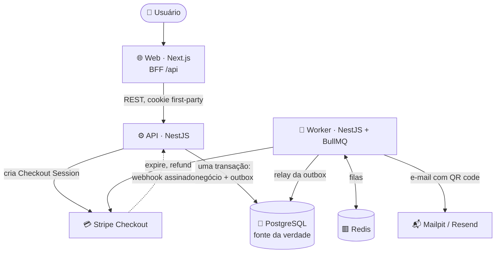
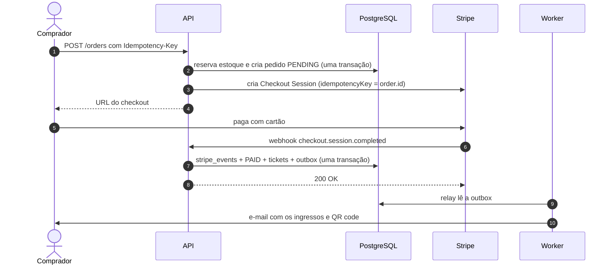
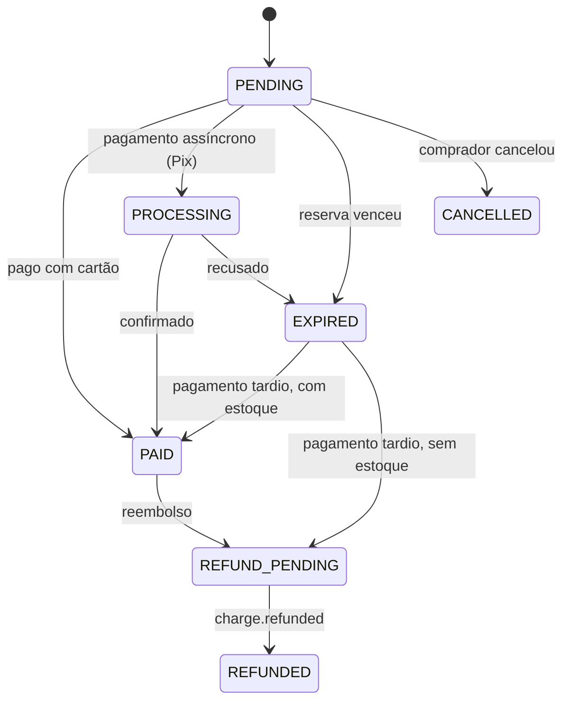
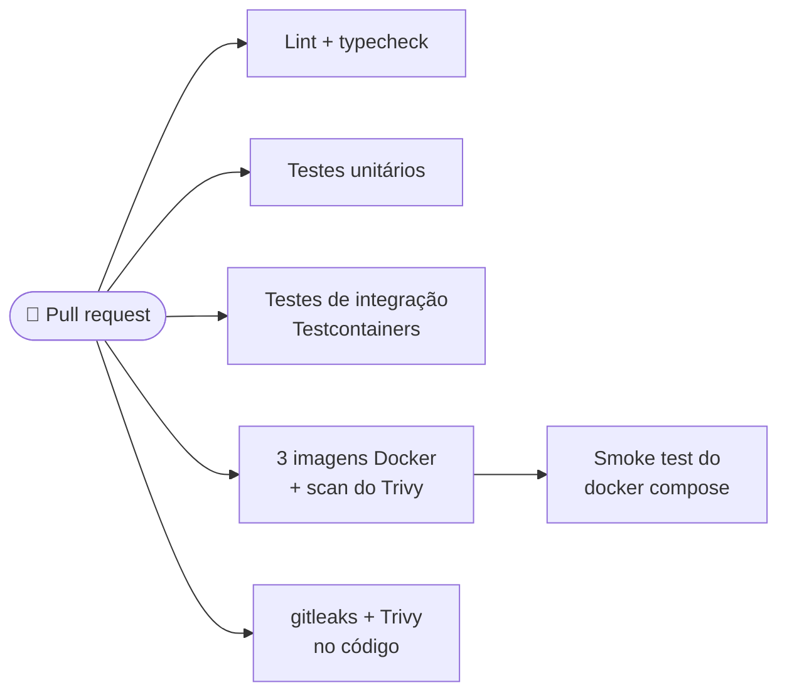

<div align="center">

# 🎟️ TicketFlow

**Venda de ingressos para eventos pequenos, sem overselling e sem cobrança duplicada.**

Stripe Checkout · reserva de estoque atômica · webhooks idempotentes · transactional outbox

[](https://github.com/ViniGHub/TicketFlow/actions/workflows/ci.yml)


[Arquitetura](ARCHITECTURE.md) · [Roadmap](ROADMAP.md) · [Decisões (ADRs)](docs/adr/) · [Como rodar](#-como-rodar-localmente)

</div>

> [!NOTE]
> **Projeto de portfólio em construção.** O foco é qualidade de engenharia (concorrência,
> idempotência, webhooks, CI/CD), não quantidade de funcionalidades. A fundação (monorepo, CI,
> banco e autenticação), o catálogo de eventos e o núcleo de pedidos estão prontos; o pedido já
> abre o Stripe Checkout, e a confirmação do pagamento pelo webhook vem na próxima etapa.

> [!IMPORTANT]
> O Stripe roda em **modo teste**: nenhuma cobrança real é feita. Para pagar, use o cartão
> `4242 4242 4242 4242`, qualquer data futura e qualquer CVC.

## 🎯 O que o projeto resolve

Vender ingresso parece simples até surgirem os problemas reais:

|     | Problema                                                        | Como o TicketFlow resolve                                                                         |
| --- | --------------------------------------------------------------- | ------------------------------------------------------------------------------------------------- |
| 🏁  | **Concorrência:** 50 pessoas disputando os últimos 10 ingressos | Decremento atômico (`UPDATE ... WHERE available >= qty`) com `CHECK` no banco como segunda defesa |
| 🔁  | **Idempotência:** o Stripe reenvia webhooks                     | `event.id` gravado com `UNIQUE` na mesma transação do processamento                               |
| ✅  | **Consistência:** o comprador fecha a aba depois de pagar       | Quem confirma o pagamento é o webhook assinado, nunca o front-end                                 |
| ⚙️  | **Assincronismo:** e-mail, expiração e reembolso                | Transactional outbox + BullMQ: um pedido pago nunca fica sem e-mail por falha do Redis            |

## 🏗️ Arquitetura



- **O Postgres é a fonte da verdade.** O Redis só transporta trabalho: se for zerado, nada
  se perde, porque os jobs nascem da tabela `outbox`.
- **Nenhuma chamada HTTP externa dentro de transação de banco.**
- Detalhes, modelo de dados e regras em [ARCHITECTURE.md](ARCHITECTURE.md).

### Fluxo de uma compra



### Estados do pedido



A máquina de estados vive em `packages/domain`; qualquer transição fora deste diagrama lança
erro.

## 📦 Monorepo

```
ticketflow/
├── apps/
│   ├── web/          # Next.js (App Router) + Tailwind, BFF via rewrites
│   ├── api/          # NestJS (HTTP)
│   └── worker/       # NestJS standalone + BullMQ
└── packages/
    ├── db/           # Prisma: schema, migrations, seed, client
    ├── domain/       # regras de negócio puras
    ├── payments/     # adaptador do Stripe Checkout e gateway fake
    ├── contracts/    # schemas zod compartilhados
    ├── config/       # tsconfig, ESLint, Prettier, Vitest
    └── testing/      # helpers de Testcontainers
```

| Camada    | Tecnologia                                                |
| --------- | --------------------------------------------------------- |
| Front-end | Next.js, TypeScript, Tailwind                             |
| API       | NestJS, TypeScript, OpenAPI                               |
| Worker    | NestJS standalone + BullMQ + Redis (transactional outbox) |
| Banco     | PostgreSQL 17 + Prisma 7                                  |
| Pagamento | Stripe Checkout (modo teste)                              |
| E-mail    | Mailpit (dev) / Resend (prod)                             |
| Monorepo  | pnpm workspaces + Turborepo                               |
| Testes    | Vitest, Testcontainers, Playwright                        |
| Infra     | Docker, GitHub Actions, GHCR, OpenTelemetry               |

## 🗺️ Progresso

| Fase                        | Objetivo                                  | Status       |
| --------------------------- | ----------------------------------------- | ------------ |
| 1. Fundação                 | Monorepo, CI, banco e autenticação        | ✅ concluída |
| 2. Catálogo                 | Eventos e lotes                           | ✅ concluída |
| 3. Núcleo transacional      | Pedidos e estoque à prova de concorrência | ✅ concluída |
| 4. Pagamentos e ingressos   | Stripe Checkout, webhook e check-in       | ⏳ em curso  |
| 5. Processamento assíncrono | Outbox, e-mail, expiração e reembolso     | ⬜ a fazer   |
| 6. Front-end                | Jornada do comprador e do organizador     | ⬜ a fazer   |
| 7. Produção                 | Observabilidade, deploy e segurança       | ⬜ a fazer   |
| 8. Portfólio                | Documentação e material de entrevista     | ⬜ a fazer   |

<details>
<summary><b>O que foi entregue na fase 1</b></summary>

- ✅ **1.1 Bootstrap:** monorepo, TypeScript estrito, ESLint, Prettier, Vitest, validação de
  variáveis de ambiente com zod, commits no padrão Conventional Commits.
- ✅ **1.2 Infra e CI:** Docker Compose, Dockerfiles multi-stage com usuário não-root,
  Testcontainers e pipeline de CI completo.
- ✅ **1.3 Banco:** schema completo, CHECKs de estoque, índices parciais e seed de
  desenvolvimento.
- ✅ **1.4 Autenticação:** cookies httpOnly, refresh token rotacionado com detecção de reuso,
  rate limit em Redis, Swagger, health checks e logs com request id.

</details>

<details>
<summary><b>O que foi entregue na fase 2</b></summary>

- ✅ **2.1 Eventos e lotes:** catálogo público paginado por cursor, gestão de eventos e lotes
  pelo organizador dono (404 para evento alheio), regras de janela de vendas e de total
  abaixo do vendido em `packages/domain`, e escritas serializadas pela trava do evento.

</details>

<details>
<summary><b>O que foi entregue na fase 3</b></summary>

- ✅ **3.1 Domínio do pedido:** máquina de estados testada nos 49 pares origem × destino, com
  cobertura de 100% exigida no CI, efeito de cada transição no estoque, erros e total do
  pedido em centavos, e portas de repositório, transação e pagamento sem implementação.
- ✅ **3.2 Reserva de estoque e criação de pedido:** `POST /orders` com decremento atômico em
  ordem de lote, trava compartilhada do evento, `Idempotency-Key` resistente a requisições
  simultâneas e rate limit por comprador. Testado com 50 compradores disputando 10 ingressos,
  em 10 rodadas seguidas.
- ✅ **3.3 Cancelamento e expiração local:** `POST /orders/:id/cancel` e `ExpirationService`
  no domínio. A sessão do Stripe expira fora da transação; depois o pedido é travado e
  reconferido, então o estoque volta uma vez só, mesmo com expirações e cancelamentos
  simultâneos.

</details>

<details>
<summary><b>O que já foi entregue na fase 4</b></summary>

- ✅ **4.1 Stripe Checkout:** `POST /orders` abre a Checkout Session depois do commit da
  reserva, com a `idempotencyKey` do pedido e parâmetros que só dependem dele, então a
  retentativa recebe a mesma sessão. Se o Stripe falha, o pedido é cancelado e o estoque volta.
  `GET /orders/:id` só para o dono. O adaptador fica num pacote próprio, reutilizável pelo
  worker, e os testes usam um gateway fake.
- ✅ **4.2 Webhook transacional:** `POST /webhooks/stripe` confere a assinatura sobre o corpo
  cru e processa cada evento numa transação: registro em `stripe_events`, pedido travado,
  `PAID` com um ingresso por unidade e o e-mail na outbox, ou `EXPIRED` com o estoque de volta.
  O mesmo evento entregue várias vezes, inclusive ao mesmo tempo, é processado uma vez; uma
  falha no meio desfaz tudo e responde 500, para o Stripe reenviar.

</details>

O plano completo, com escopo e critérios de aceite de cada etapa, está no
[ROADMAP.md](ROADMAP.md).

## 🚀 Como rodar localmente

Pré-requisitos: **Docker**, **Node 24 LTS**, **pnpm** e a
[Stripe CLI](https://stripe.com/docs/stripe-cli).

```bash
git clone https://github.com/ViniGHub/TicketFlow.git
cd TicketFlow
cp .env.example .env          # preencha as chaves de teste do Stripe
docker compose up -d          # postgres, redis, mailpit
pnpm install
pnpm --filter @ticketflow/db prisma migrate dev
pnpm turbo run build --filter=@ticketflow/db && pnpm --filter @ticketflow/db db:seed
pnpm dev                      # web, api e worker
```

| Serviço            | Endereço                   |
| ------------------ | -------------------------- |
| 🌐 Front-end       | http://localhost:3001      |
| ⚙️ API + Swagger   | http://localhost:3000/docs |
| 📬 Caixa de e-mail | http://localhost:8025      |

<details>
<summary><b>👥 Usuários do seed</b></summary>

O seed é idempotente: pode rodar várias vezes sem duplicar dados. Todos os usuários usam a
senha `ticketflow-dev` (só para desenvolvimento local).

| E-mail                         | Papéis                  |
| ------------------------------ | ----------------------- |
| `organizador@ticketflow.local` | organizador             |
| `comprador@ticketflow.local`   | comprador               |
| `ambos@ticketflow.local`       | comprador e organizador |

Ele também cria dois eventos publicados, com lotes e janela de vendas aberta: "Jazz no
Parque" (do organizador) e "Workshop de TypeScript" (do usuário com os dois papéis, com só
10 vagas).

Para recriar o banco do zero: `pnpm --filter @ticketflow/db prisma migrate reset` e depois o
seed de novo (o Prisma 7 não roda o seed automaticamente no reset).

</details>

<details>
<summary><b>💳 Pagamento com o Stripe (modo teste)</b></summary>

1. Crie uma conta no Stripe e, no modo teste do painel (Developers → API keys), copie a chave
   secreta `sk_test_...` para `STRIPE_SECRET_KEY` no `.env`. Nunca use uma chave `sk_live_`.
2. Em outro terminal, faça login na [Stripe CLI](https://stripe.com/docs/stripe-cli) e
   encaminhe os webhooks para a API local:

   ```bash
   stripe login
   stripe listen --forward-to localhost:3000/webhooks/stripe
   # copie o whsec_... exibido para STRIPE_WEBHOOK_SECRET no .env e reinicie a API
   ```

3. Pelo Swagger (http://localhost:3000/docs), faça login como `comprador@ticketflow.local`,
   pegue o id de um lote em `GET /events/{id}` e crie o pedido em `POST /orders`. A resposta
   traz `checkoutUrl`: abra no navegador e pague com o cartão `4242 4242 4242 4242`, qualquer
   data futura e qualquer CVC.

4. Depois de pagar, o `stripe listen` mostra o `checkout.session.completed` entregue com 200, e
   `GET /orders/{id}` responde `PAID`. Os ingressos ficam na tabela `tickets`; o e-mail com
   eles sai pelo worker a partir da etapa 5.2.
5. Para conferir a idempotência, reenvie o evento com o id que o `stripe listen` mostrou. A
   API responde 200, e nenhum ingresso novo é criado:

   ```bash
   stripe events resend evt_...
   ```

A sessão vale 35 minutos (o mínimo do Stripe mais uma folga). Pedidos de R$ 0,01 a R$ 0,49
são recusados com 422, porque o Stripe só cobra a partir de R$ 0,50 em BRL. O webhook responde
400 sem assinatura válida e 500 se o processamento falhar, e aí o Stripe reenvia. Eventos de
outros tipos, ou de sessões que não são de um pedido desta instalação, são registrados e
respondem 200 sem mudar nada.

</details>

<details>
<summary><b>🐳 Tudo em containers</b></summary>

```bash
docker compose --profile app up --build
```

Os padrões do `docker-compose.yml` permitem subir mesmo sem `.env` (útil no CI); a web fica
em http://localhost:3001 e a API em http://localhost:3000/health/live.

</details>

## 🧪 Testes e CI

```bash
pnpm lint
pnpm typecheck
pnpm test                # unitários (*.spec.ts), sem dependências externas
pnpm test:integration    # integração (*.int-spec.ts): Postgres e Redis via Testcontainers
```

Os testes de integração precisam de Docker, mas **não** do `docker compose`: cada execução
sobe containers próprios e descartáveis. Sem Docker na máquina, eles rodam no CI.

Cada pull request passa por:



As dependências são atualizadas pelo Dependabot.

## 🧠 Decisões técnicas

| Decisão                                         | Por quê                                                                                                                                                                                           |
| ----------------------------------------------- | ------------------------------------------------------------------------------------------------------------------------------------------------------------------------------------------------- |
| **Webhook como fonte da verdade**               | O redirect de sucesso só mostra o status; quem confirma o pagamento é o webhook assinado                                                                                                          |
| **Estoque atômico**                             | `UPDATE ... WHERE available >= qty` em transação, com `CHECK` como segunda defesa                                                                                                                 |
| **Idempotência de webhook**                     | `event.id` com `UNIQUE` na mesma transação; se algo falhar, tudo volta e o Stripe reenvia                                                                                                         |
| **Transactional outbox**                        | Jobs nascem de uma tabela gravada junto com a mudança de negócio                                                                                                                                  |
| **Expirar no Stripe antes de devolver estoque** | Uma sessão expirada não pode ser paga: quase elimina o pagamento tardio. A chamada fica fora da transação e o pedido é reconferido depois ([ADR 0007](docs/adr/0007-expiracao-e-cancelamento.md)) |
| **Stripe Checkout hospedado**                   | Dados de cartão nunca passam pelo servidor                                                                                                                                                        |
| **Sessão em cookie httpOnly via BFF**           | O front faz proxy de `/api/*`, então o cookie é first-party                                                                                                                                       |
| **Refresh token rotacionado**                   | Reuso de um token já trocado revoga a sessão inteira: um token roubado vale no máximo uma vez ([ADR 0003](docs/adr/0003-sessao-em-cookie-e-rotacao-de-refresh.md))                                |
| **Monorepo com pnpm + Turborepo**               | Regras de domínio compartilhadas entre API e worker, sem duplicação ([ADR 0001](docs/adr/0001-monorepo-pnpm-turborepo.md))                                                                        |
| **UUID v7 e índices parciais no schema**        | IDs ordenáveis e não sequenciais; índices que o Prisma não remove ([ADR 0002](docs/adr/0002-convencoes-do-modelo-de-dados.md))                                                                    |
| **Paginação por cursor no catálogo**            | Não pula nem repete eventos durante a navegação e dispensa `COUNT(*)`; escritas travam o evento ([ADR 0004](docs/adr/0004-catalogo-cursor-e-trava-do-evento.md))                                  |
| **Máquina de estados do pedido como tabela**    | Cada par origem → destino diz se vale e o que faz com o estoque; API, worker e webhook usam a mesma regra ([ADR 0005](docs/adr/0005-dominio-do-pedido.md))                                        |
| **Compra trava o evento em modo compartilhado** | Compras não esperam umas pelas outras, mas um cancelamento de evento não passa no meio de uma compra ([ADR 0006](docs/adr/0006-criacao-de-pedido.md))                                             |
| **Checkout Session depois do commit**           | Chamada ao Stripe fora da transação, com a chave e os parâmetros do pedido; se falha, o pedido é cancelado ([ADR 0008](docs/adr/0008-checkout-session.md))                                        |

## 🔮 Depois do MVP

- [ ] Pix via Stripe
- [ ] Reembolso pelo painel do organizador
- [ ] Lembrete 24h antes do evento
- [ ] Lista de espera para eventos esgotados
- [ ] Cupons de desconto
- [ ] Teste de carga com k6

## 📄 Licença

MIT
