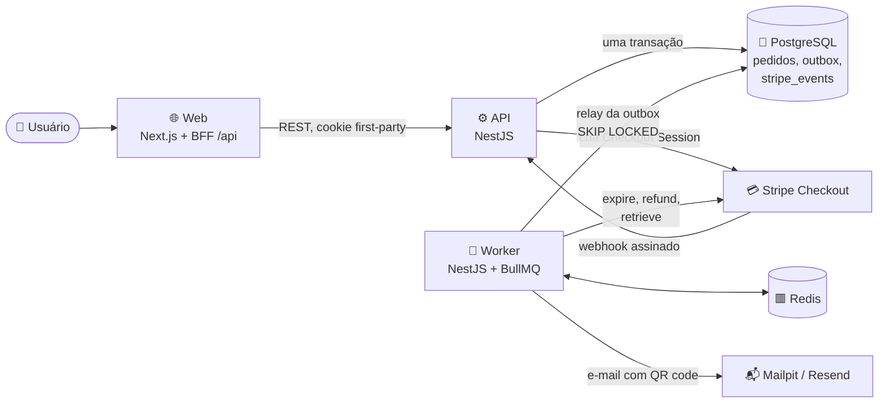
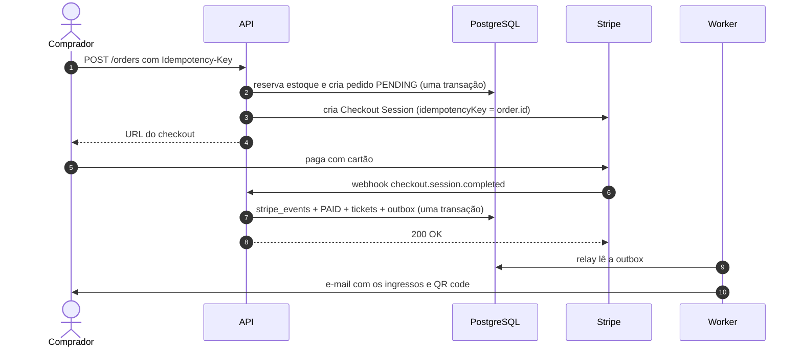
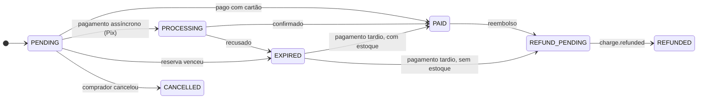
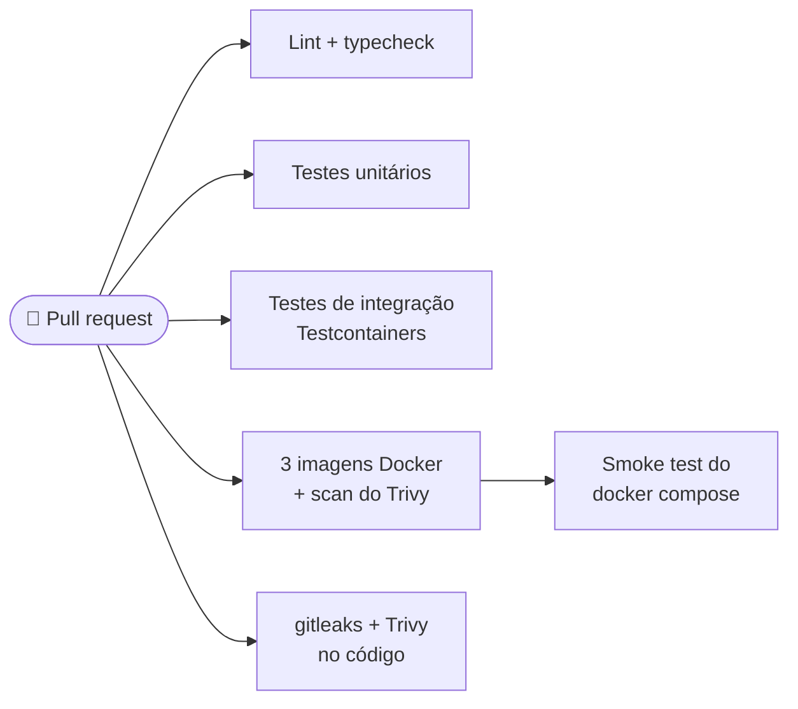

<div align="center">

# 🎟️ TicketFlow

**Venda de ingressos para eventos pequenos, sem overselling e sem cobrança duplicada.**

Stripe Checkout · reserva de estoque atômica · webhooks idempotentes · transactional outbox

[](https://github.com/ViniGHub/TicketFlow/actions/workflows/ci.yml)


[Arquitetura](ARCHITECTURE.md) · [Roadmap](ROADMAP.md) · [Decisões (ADRs)](docs/adr/) · [Como rodar](#-como-rodar-localmente)

</div>

> [!NOTE]
> **Projeto de portfólio em construção.** O foco é qualidade de engenharia (concorrência,
> idempotência, webhooks, CI/CD), não quantidade de funcionalidades. A fundação está pronta
> (monorepo, CI, banco); autenticação, pedidos e pagamentos vêm nas próximas etapas.

> [!IMPORTANT]
> O Stripe roda em **modo teste**: nenhuma cobrança real é feita. Para pagar, use o cartão
> `4242 4242 4242 4242`, qualquer data futura e qualquer CVC.

## 🎯 O que o projeto resolve

Vender ingresso parece simples até surgirem os problemas reais:

|     | Problema                                                        | Como o TicketFlow resolve                                                                         |
| --- | --------------------------------------------------------------- | ------------------------------------------------------------------------------------------------- |
| 🏁  | **Concorrência:** 50 pessoas disputando os últimos 10 ingressos | Decremento atômico (`UPDATE ... WHERE available >= qty`) com `CHECK` no banco como segunda defesa |
| 🔁  | **Idempotência:** o Stripe reenvia webhooks                     | `event.id` gravado com `UNIQUE` na mesma transação do processamento                               |
| ✅  | **Consistência:** o comprador fecha a aba depois de pagar       | Quem confirma o pagamento é o webhook assinado, nunca o front-end                                 |
| ⚙️  | **Assincronismo:** e-mail, expiração e reembolso                | Transactional outbox + BullMQ: um pedido pago nunca fica sem e-mail por falha do Redis            |

## 🏗️ Arquitetura



- **O Postgres é a fonte da verdade.** O Redis só transporta trabalho: se for zerado, nada
  se perde, porque os jobs nascem da tabela `outbox`.
- **Nenhuma chamada HTTP externa dentro de transação de banco.**
- Detalhes, modelo de dados e regras em [ARCHITECTURE.md](ARCHITECTURE.md).

### Fluxo de uma compra



### Estados do pedido



A máquina de estados vive em `packages/domain`; qualquer transição fora deste diagrama lança
erro.

## 📦 Monorepo

```
ticketflow/
├── apps/
│   ├── web/          # Next.js (App Router) + Tailwind, BFF via rewrites
│   ├── api/          # NestJS (HTTP)
│   └── worker/       # NestJS standalone + BullMQ
└── packages/
    ├── db/           # Prisma: schema, migrations, seed, client
    ├── domain/       # regras de negócio puras
    ├── contracts/    # schemas zod compartilhados
    ├── config/       # tsconfig, ESLint, Prettier, Vitest
    └── testing/      # helpers de Testcontainers
```

| Camada    | Tecnologia                                                |
| --------- | --------------------------------------------------------- |
| Front-end | Next.js, TypeScript, Tailwind                             |
| API       | NestJS, TypeScript, OpenAPI                               |
| Worker    | NestJS standalone + BullMQ + Redis (transactional outbox) |
| Banco     | PostgreSQL 17 + Prisma 7                                  |
| Pagamento | Stripe Checkout (modo teste)                              |
| E-mail    | Mailpit (dev) / Resend (prod)                             |
| Monorepo  | pnpm workspaces + Turborepo                               |
| Testes    | Vitest, Testcontainers, Playwright                        |
| Infra     | Docker, GitHub Actions, GHCR, OpenTelemetry               |

## 🗺️ Progresso

| Fase                        | Objetivo                                  | Status                           |
| --------------------------- | ----------------------------------------- | -------------------------------- |
| 1. Fundação                 | Monorepo, CI, banco e autenticação        | 🟡 3 de 4 (falta a autenticação) |
| 2. Catálogo                 | Eventos e lotes                           | ⬜ a fazer                       |
| 3. Núcleo transacional      | Pedidos e estoque à prova de concorrência | ⬜ a fazer                       |
| 4. Pagamentos e ingressos   | Stripe Checkout, webhook e check-in       | ⬜ a fazer                       |
| 5. Processamento assíncrono | Outbox, e-mail, expiração e reembolso     | ⬜ a fazer                       |
| 6. Front-end                | Jornada do comprador e do organizador     | ⬜ a fazer                       |
| 7. Produção                 | Observabilidade, deploy e segurança       | ⬜ a fazer                       |
| 8. Portfólio                | Documentação e material de entrevista     | ⬜ a fazer                       |

<details>
<summary><b>O que já está pronto na fase 1</b></summary>

- ✅ **1.1 Bootstrap:** monorepo, TypeScript estrito, ESLint, Prettier, Vitest, validação de
  variáveis de ambiente com zod, commits no padrão Conventional Commits.
- ✅ **1.2 Infra e CI:** Docker Compose, Dockerfiles multi-stage com usuário não-root,
  Testcontainers e pipeline de CI completo.
- ✅ **1.3 Banco:** schema completo, CHECKs de estoque, índices parciais e seed de
  desenvolvimento.
- ⏳ **1.4 Autenticação:** cookies httpOnly, refresh token rotacionado, rate limit.

</details>

O plano completo, com escopo e critérios de aceite de cada etapa, está no
[ROADMAP.md](ROADMAP.md).

## 🚀 Como rodar localmente

Pré-requisitos: **Docker**, **Node 24 LTS**, **pnpm** e a
[Stripe CLI](https://stripe.com/docs/stripe-cli).

```bash
git clone https://github.com/ViniGHub/TicketFlow.git
cd TicketFlow
cp .env.example .env          # preencha as chaves de teste do Stripe
docker compose up -d          # postgres, redis, mailpit
pnpm install
pnpm --filter @ticketflow/db prisma migrate dev
pnpm turbo run build --filter=@ticketflow/db && pnpm --filter @ticketflow/db db:seed
pnpm dev                      # web, api e worker
```

| Serviço            | Endereço                          |
| ------------------ | --------------------------------- |
| 🌐 Front-end       | http://localhost:3001             |
| ⚙️ API (health)    | http://localhost:3000/health/live |
| 📬 Caixa de e-mail | http://localhost:8025             |

<details>
<summary><b>👥 Usuários do seed</b></summary>

O seed é idempotente: pode rodar várias vezes sem duplicar dados. Todos os usuários usam a
senha `ticketflow-dev` (só para desenvolvimento local).

| E-mail                         | Papéis                  |
| ------------------------------ | ----------------------- |
| `organizador@ticketflow.local` | organizador             |
| `comprador@ticketflow.local`   | comprador               |
| `ambos@ticketflow.local`       | comprador e organizador |

Ele também cria dois eventos publicados, com lotes e janela de vendas aberta: "Jazz no
Parque" (do organizador) e "Workshop de TypeScript" (do usuário com os dois papéis, com só
10 vagas).

Para recriar o banco do zero: `pnpm --filter @ticketflow/db prisma migrate reset` e depois o
seed de novo (o Prisma 7 não roda o seed automaticamente no reset).

</details>

<details>
<summary><b>💳 Webhooks do Stripe</b></summary>

Em outro terminal, encaminhe os webhooks do Stripe para a API local:

```bash
stripe listen --forward-to localhost:3000/webhooks/stripe
# copie o whsec_... exibido para STRIPE_WEBHOOK_SECRET no .env
```

</details>

<details>
<summary><b>🐳 Tudo em containers</b></summary>

```bash
docker compose --profile app up --build
```

Os padrões do `docker-compose.yml` permitem subir mesmo sem `.env` (útil no CI); a web fica
em http://localhost:3001 e a API em http://localhost:3000/health/live.

</details>

## 🧪 Testes e CI

```bash
pnpm lint
pnpm typecheck
pnpm test                # unitários (*.spec.ts), sem dependências externas
pnpm test:integration    # integração (*.int-spec.ts): Postgres e Redis via Testcontainers
```

Os testes de integração precisam de Docker, mas **não** do `docker compose`: cada execução
sobe containers próprios e descartáveis. Sem Docker na máquina, eles rodam no CI.

Cada pull request passa por:



As dependências são atualizadas pelo Dependabot.

## 🧠 Decisões técnicas

| Decisão                                         | Por quê                                                                                                                        |
| ----------------------------------------------- | ------------------------------------------------------------------------------------------------------------------------------ |
| **Webhook como fonte da verdade**               | O redirect de sucesso só mostra o status; quem confirma o pagamento é o webhook assinado                                       |
| **Estoque atômico**                             | `UPDATE ... WHERE available >= qty` em transação, com `CHECK` como segunda defesa                                              |
| **Idempotência de webhook**                     | `event.id` com `UNIQUE` na mesma transação; se algo falhar, tudo volta e o Stripe reenvia                                      |
| **Transactional outbox**                        | Jobs nascem de uma tabela gravada junto com a mudança de negócio                                                               |
| **Expirar no Stripe antes de devolver estoque** | Uma sessão expirada não pode ser paga: quase elimina o pagamento tardio                                                        |
| **Stripe Checkout hospedado**                   | Dados de cartão nunca passam pelo servidor                                                                                     |
| **Sessão em cookie httpOnly via BFF**           | O front faz proxy de `/api/*`, então o cookie é first-party                                                                    |
| **Monorepo com pnpm + Turborepo**               | Regras de domínio compartilhadas entre API e worker, sem duplicação ([ADR 0001](docs/adr/0001-monorepo-pnpm-turborepo.md))     |
| **UUID v7 e índices parciais no schema**        | IDs ordenáveis e não sequenciais; índices que o Prisma não remove ([ADR 0002](docs/adr/0002-convencoes-do-modelo-de-dados.md)) |

## 🔮 Depois do MVP

- [ ] Pix via Stripe
- [ ] Reembolso pelo painel do organizador
- [ ] Lembrete 24h antes do evento
- [ ] Lista de espera para eventos esgotados
- [ ] Cupons de desconto
- [ ] Teste de carga com k6

## 📄 Licença

MIT
